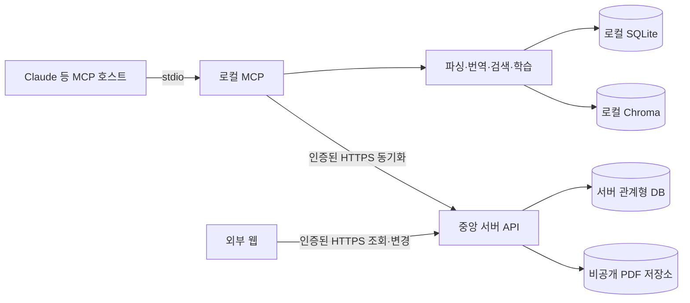

# 24. 로컬 MCP와 중앙 서버 병행 전환 결정

작성일: 2026-11-12  
상태: 채택(ADR) / 구현 전

## 결정

첫 서버 전환은 로컬 MCP를 제거하거나 곧바로 원격 MCP로 바꾸는 작업으로 진행하지 않는다.
로컬 MCP가 현재의 논문 처리·학습 기능을 유지하고, 외부 웹과 로컬 MCP가 함께 사용하는
인증된 중앙 서버 API를 추가한다.

- 로컬 MCP는 PDF 파싱, 번역, 임베딩, 검색과 학습 실행을 담당한다.
- 중앙 서버는 계정·기기, 동기화된 논문·학습 기록, 컬렉션, 선택적으로 업로드한 PDF를 보관한다.
- 외부 웹은 중앙 서버 API만 사용하며 로컬 SQLite·Chroma나 서버 DB에 직접 접근하지 않는다.
- 로컬 MCP도 서버 DB에 직접 접근하지 않고 인증된 서버 API를 사용한다.
- 원격 MCP transport와 서버 측 파싱·번역·임베딩 실행은 후속 결정으로 분리한다.

## 배경

현재 기준은 단일 OS 사용자와 로컬 데이터 루트를 신뢰 경계로 삼는 stdio MCP다.
SQLite·Chroma·PDF와 작업자가 모두 로컬 런타임에 있으며 서비스 로그인과 사용자 간 격리가 없다.
외부 웹은 이 로컬 저장소를 직접 읽을 수 없으므로 로그인한 사용자의 데이터를 표시하려면
중앙 서버와 동기화 경계가 필요하다.

원격 MCP 전면 전환은 transport 변경만으로 끝나지 않는다. 다중 사용자 격리, PDF 업로드,
영속 작업 큐, 비용·동시 실행 제한, 사용자별 검색 저장소, 장애 복구와 호스트별 원격 연결을
함께 해결해야 한다. 외부 웹의 첫 조회 기능에는 이 전체 범위가 필요하지 않으므로 서버 동기화와
원격 실행을 분리한다.

## 책임 경계

| 영역 | 첫 서버 단계의 책임 |
|---|---|
| 로컬 MCP | 로컬 기능 실행, 동기화 동의 확인, outbox 재시도, 로컬 ID와 서버 ID 매핑 |
| 중앙 서버 API | 인증, 사용자 소유권 검증, 멱등 저장, 충돌 검사, 웹 조회 계약 |
| 서버 DB | 웹과 기기 간 공유할 기준 기록, 서버 ID·수정 버전·동의 이력 |
| PDF 저장소 | 사용자가 별도로 동의한 원문 파일과 업로드 상태 |
| 외부 웹 | 서버에 확정된 데이터 조회와 컬렉션 관리; 새 AI 결과 생성은 하지 않음 |
| 로컬 SQLite·Chroma | 로컬 실행과 오프라인 사용의 기준; Chroma는 계속 재구축 가능한 파생 데이터 |

서버 저장 성공 전에는 원격 저장 완료로 표시하지 않는다. 반대로 동기화 실패가 기존 로컬
학습을 막아서는 안 된다. 서버에 확정된 기록은 외부 웹과 기기 간 동기화의 기준이지만,
첫 단계에서 로컬 데이터를 자동 삭제하거나 서버 데이터로 전면 교체하지 않는다.

## 동기화 범위

기본 동기화 후보는 다음과 같다. 실제 전송은 연결된 계정과 사용자의 승인 범위 안에서만 한다.

- 논문 기본정보와 원래 등록일
- 원문 버전 메타데이터, 파일명과 파일 검증값
- 학습 기록, 실제 마지막 학습 위치·시각과 읽기 상태
- 저장된 요약과 해당 근거 연결
- 메모·하이라이트, 선택 구간과 저장 당시 인용문
- 사용자가 선택한 PDF 파일

다음 항목은 기본 동기화 대상이 아니다.

- 전체 추출 원문과 전체 번역문
- Chroma 벡터와 로컬 모델 캐시
- 로컬 절대경로
- 외부 API 키·인증 토큰
- 일반 진단 로그

PDF 업로드는 기록 동기화와 별도 선택이다. PDF를 업로드하지 않거나 업로드에 실패해도 참조가
완전한 논문 정보·학습 기록·메모는 저장할 수 있어야 한다. 동기화를 통해 서버에 보내는 인용문과
외부 AI 제공자에게 보내는 본문은 목적·수신자·동의가 다르므로 하나의 동의로 합치지 않는다.

## 식별자와 충돌 원칙

- 서버는 논문·원문 버전·학습 기록·메모 등 각 객체에 서버 ID를 발급한다.
- 로컬 출처 인스턴스, 로컬 객체 ID와 서버 ID의 매핑을 로컬과 서버에 보존한다.
- 제목이나 메모 본문이 같다는 이유만으로 서로 다른 객체를 자동 병합하지 않는다.
- 최초 등록은 안정적인 로컬 식별자와 멱등 요청 키를 함께 사용한다.
- 같은 키와 같은 payload의 재전송은 기존 처리 결과를 반환한다.
- 같은 키에 다른 payload가 오면 충돌로 거부한다.
- 수정은 마지막으로 확인한 서버 수정 버전을 포함하며 오래된 수정이 최신 값을 덮지 못하게 한다.
- 일부 객체의 저장 실패를 전체 동기화 성공으로 표시하지 않는다.

구체적인 전송 순서와 상태 계약은
[서버 동기화 데이터 흐름](../setup/server-sync-data-flow.md)과
[서버 동기화·동의·충돌 정책](../setup/server-sync-policy.md)을 따른다.

## 첫 구현 세로 조각

첫 구현은 논문 한 건으로 다음 흐름만 완성한다.

1. 웹 사용자와 로컬 기기를 같은 서버 계정에 연결한다.
2. 사용자가 선택한 로컬 논문 메타데이터를 서버에 등록한다.
3. 서버가 서버 논문 ID와 수정 버전을 반환한다.
4. 로컬은 ID 매핑과 서버 저장 결과를 보존한다.
5. 동일 요청을 재전송해도 중복 논문이 생기지 않는다.
6. 외부 웹의 논문 목록 API에서 같은 논문을 조회한다.
7. 다른 사용자의 인증으로는 존재 여부나 내용을 확인할 수 없다.
8. 서버 장애 중에도 기존 로컬 MCP 기능은 계속 사용할 수 있다.

첫 세로 조각에는 PDF 파일, 전체 원문·번역문, 벡터, 서버 파싱 worker와 원격 MCP를 포함하지 않는다.

## 단계별 확장

1. 인증·기기·사용자 소유권 경계
2. 논문 및 원문 버전 메타데이터 동기화
3. 학습 기록·진행 위치·읽기 상태 동기화
4. 근거·요약·메모·하이라이트 동기화
5. 논문 목록·상세·기록 조회 API
6. 컬렉션 API
7. 선택적 PDF 업로드·열람
8. 웹에서 로컬 MCP로 학습 이어하기
9. 서버 작업자와 원격 MCP의 필요성 재평가

## 원격 MCP 재평가 조건

다음 조건을 충족한 뒤 원격 MCP transport와 서버 측 논문 처리를 별도 ADR로 결정한다.

- 다중 사용자 소유권 격리와 기기 해제 검증
- PDF 보존·삭제·백업 및 용량 정책 확정
- 영속 작업 상태, 중복 방어, 재시도와 장애 복구 검증
- 사용자별 비용·사용량·동시 실행 제한 확정
- 서버 파싱·번역·임베딩 worker의 운영 검증
- 대상 MCP 호스트의 원격 transport와 인증 지원 확인
- 로컬형과 원격형의 데이터 호환·이관 정책 확정

## 결과와 트레이드오프

### 장점

- 현재 로컬 기능과 배포 경로를 유지하며 웹 데이터 경계를 작은 단위로 검증할 수 있다.
- 외부 웹 개발이 원격 파싱·검색 인프라 완성을 기다리지 않아도 된다.
- 서버 장애나 오프라인 상태에서도 로컬 학습을 유지할 수 있다.
- 원격 MCP가 필요하지 않거나 호스트 지원이 부족해도 서버·웹 투자가 유효하다.

### 비용

- 로컬과 서버에 기록이 함께 존재하므로 ID 매핑, outbox, 충돌과 동의 상태가 필요하다.
- 동기화되지 않은 로컬 변경은 외부 웹에 즉시 보이지 않는다.
- 첫 단계에는 다른 PC에서 전체 검색 환경을 그대로 복원할 수 없다.
- 이후 원격 실행을 도입하면 서버 작업자와 검색 저장소를 추가 설계해야 한다.

## 대안

### 원격 MCP 전면 전환을 먼저 수행

웹과 실행 환경을 한 서버에 모을 수 있지만 첫 외부 화면보다 훨씬 큰 인증·작업·비용·운영 범위를
동시에 요구한다. 현재 단계에서는 채택하지 않는다.

### 로컬 웹 서버만 제공

서버 동기화 없이 구현할 수 있지만 같은 PC에서만 안정적으로 사용할 수 있고 로그인 기반의
다른 PC·모바일 조회라는 외부 사이트 목표를 충족하지 못한다. 제품 목표의 대안으로 채택하지 않는다.

## 관련 문서와 티켓

- [M1 로컬 실행 기준](22-local-m1-baseline.md)
- [MCP 인터페이스 명세](10-mcp-contracts.md)
- [외부 전송 데이터와 실행 시점](../setup/external-data-transfer.md)
- GitHub #77 원격 MCP 서비스 전환 설계
- GitHub #124~#126 외부 논문·메모 화면 API
- GitHub #134, #211 컬렉션 API
- GitHub #212~#216 계정·동기화·PDF·이어하기
