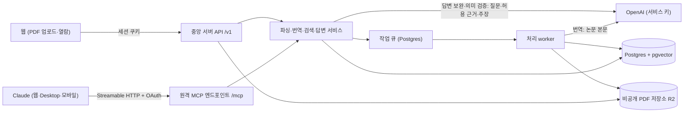

# 25. 원격 MCP 전환 설계 (#77)

작성일: 2026-11-15
상태: 제안 / 팀 합의 전 (A·B·C 1차 검토와 재검토 반영, 2026-11-15)

## 요약

사용자가 Python·PyTorch·모델·API 키를 설치하지 않고 **Claude에 커넥터 URL 하나를 추가하고
로그인하는 것만으로** 논문 학습을 시작하게 한다. 논문 처리(파싱·번역·임베딩·검색·답변)를
중앙 서버로 옮기고, 같은 서버가 Streamable HTTP MCP 엔드포인트를 제공한다.

[24. 로컬 MCP와 중앙 서버 병행 전환 결정](24-hybrid-server-transition.md)은 원격 MCP를 "재평가 조건"
충족 뒤로 미뤘다. 이 문서는 그 조건별 설계 방향과 후속 티켓 범위를 제안한다.
로컬 stdio MCP는 지금처럼 유지한다(병행 운영). 원격형이 안정화되기 전에 로컬형을 제거하지 않는다.

외부 AI 제공자에는 번역 때의 논문 본문뿐 아니라 질문 실행 때의 질문·허용 근거·주장도 전송된다(설계 결정 9).
그림의 App → OpenAI는 전송이 있다는 표시이며, 질문 실행을 API 프로세스와 worker 중 어디에서 돌릴지는 설계 결정 7에서 정한다.

## 왜 지금 다시 보는가

- 로컬 설치가 8단계 정도로 길다. Python 3.12, venv, PyTorch를 포함한 wheel, `settings.env` 직접 작성(평문 API 키),
  `check`, `prepare-model`, `config`, Desktop 설정 JSON 병합을 거친다.
- Windows 첫 임베딩은 25초 중 22초가 PyTorch 계열 import였다(#119 실측, 2026-11-14).
  로컬 stdio MCP는 Desktop의 60초 대기에 걸릴 수 있다.
- 24번의 단계 중 인증·기기, 논문 동기화, 학습 기록, 목록·상세 API, 컬렉션, PDF 업로드 API가
  구현되어(메모·PDF 열람·이어하기는 #213~#215에서 진행 중) 원격형이 쓸 수 있는 기반(Auth0, Postgres, R2, 업로드 검증, 사용자 소유권 검사)이 있다.

## 이 문서의 표기

A·B·C 검토(#77, 2026-11-15)를 반영해 각 항목의 확정 정도를 구분한다.

- **[합의]** A·B·C가 #77에서 동의한 방향
- **[제안]** 값이나 방식이 아직 합의되지 않은 안. 후속 티켓에서 확정한다
- **[권장안]** 재검토(#77, 2026-11-15)에서 담당 검토자가 권장했고 다른 검토자의 반대가 없던 안. 결정이 아니며 스파이크·실측·후속 티켓에서 확정한다
- **[미검증]** 문서·공식 안내로만 확인했고 실제 연결로 확인하지 않은 사실

이 문서는 24번 ADR을 대체하지 않는다. 24번의 병행 운영 위에 **원격 실행을 더하는 확장 제안**이다.
24번의 재평가 조건 중 호스트 연결은 아래에 구분한 환경에서 부분 실측했다.
이 연결 실측은 사용자 격리·작업 큐·비용 제한·worker 운영·백업과 복구의 완료 근거가 아니다.
각 후속 티켓의 구현·검증 상태를 별도로 확인한다. 문서 병합은 원격 전환이나 운영 배포 승인을 뜻하지 않는다.

## Claude 원격 커넥터 요건 [부분 실측]

2026-11-15에 아래 공식 문서를 읽어 정리했다. 아래 요건 표의 문서상 지원 범위와
실제 검증 범위는 다르다. 2026-11-16의 macOS Desktop Pro 연결·갱신 및 독립 PKCE 검증은
[스테이징 실측 기록](../setup/remote-mcp-staging-validation.md)에 기록했다. 다른 호스트·요금제,
300초 대기 및 published identity 호환성은 여전히 미검증이다.

출처: [Claude connectors 문서](https://claude.com/docs/connectors/building.md),
[인증 문서](https://www.claude.com/docs/connectors/building/authentication),
[커스텀 커넥터 시작 안내](https://support.claude.com/en/articles/11175166-get-started-with-custom-connectors-using-remote-mcp),
[커넥터 구축 안내](https://support.claude.com/en/articles/11503834).

| 항목 | 내용 | 우리에게 주는 의미 |
|---|---|---|
| Transport | Streamable HTTP 권장(HTTP+SSE는 폐지 예정) | 현재 FastMCP의 `streamable_http_app()`으로 제공 |
| 사용 위치 | claude.ai, Desktop, 모바일, Claude Code. 사용자는 Settings > Connectors에서 URL 추가 | Desktop의 `claude_desktop_config.json`에는 원격 서버를 넣지 않는다 |
| 요금제 | Free·Pro·Max·Team·Enterprise 모두 지원. **Free는 커스텀 커넥터 1개로 제한** | 무료 사용자도 대상이 될 수 있다. 실제 연결은 대상 계정에서 확인 |
| 인증 | OAuth 2.0 + PKCE(S256). 현재 설정 UI의 OAuth client 선택지는 Claude published identity(권장), 자동 등록, 직접 등록한 client | published identity의 Auth0 호환성을 먼저 확인하고 DCR·등록 프록시는 대안으로 비교(미결 1) |
| 발견 | 인증 없는 요청에 401 + `WWW-Authenticate: Bearer resource_metadata=".../.well-known/oauth-protected-resource"` | 보호 리소스 메타데이터의 `resource`는 사용자가 입력한 MCP URL과 정확히 같아야 함 |
| 콜백 | `https://claude.ai/api/mcp/auth_callback`(향후 `https://claude.com/api/mcp/auth_callback`도 허용) | 허용 콜백에 둘 다 등록 |
| 토큰 | 만료 5분 전 선제 갱신, 401 시 갱신. 공개 클라이언트는 refresh token 회전 필요 | refresh token rotation과 폐기 처리 |
| 도구 대기 시간 | claude.ai·Desktop 300초 | 호스트 대기만 늘어난다. 아래 "시간 예산" 참고 |
| 결과 크기 | 약 150,000자 | 현재 [응답 크기 제한](../setup/url-response-size-limits.md) 안 |
| 송신 IP | `160.79.104.0/21` | WAF 사용 시 허용 |
| 미지원 | 리소스 구독, sampling, client_credentials | 현재 도구는 사용하지 않음 |
| 첨부 파일 | 대화에 첨부한 파일이 MCP 서버에 전달된다는 문서 없음 | PDF는 웹 업로드로 받는다 |
| MCP Apps(UI 카드) | 위 문서에 언급 없음 | 원격에서 카드 렌더링 여부를 스파이크로 확인(미결 4) |

## 사용자 흐름 (MVP) [합의: 방향]

1. 사용자가 Claude Settings > Connectors에서 `https://<서비스 도메인>/mcp`를 추가하고 로그인한다.
2. "이 논문 공부하고 싶어"라고 하면 MCP가 **웹 업로드 진입 링크**를 돌려준다. 사용자는 링크를 열어 로그인된 웹에서 PDF를 선택한다.
3. 업로드와 검증이 끝나고 사용자가 처리에 동의하면 서버가 처리 작업을 큐에 넣는다. MCP의 상태 도구가 진행률을 보여준다.
4. 준비가 끝나면 `start_learning` → `ask_paper` → `get_evidence` 흐름은 지금과 같다.
5. 다른 기기·웹에서 같은 계정으로 이어서 학습한다. **처음부터 원격에서 만든 데이터**는 동기화 단계가 필요 없다.

대화 첨부 파일이 자동으로 전달된다고 가정하지 않는다. 로컬 파일 경로를 받는 도구와 로컬 PDF 열기는 원격 MCP에서 제공하지 않는다.

## 설계 결정

### 1. 운영 형태: 병행 [합의]

| 형태 | 대상 | 처리 위치 | API 키 | 설치 |
|---|---|---|---|---|
| 원격형(신규) | 일반 사용자 | 서버 | 서비스 키 | 커넥터 URL 추가 |
| 로컬형(유지) | 개발자·오프라인·비용을 직접 부담하려는 사용자 | 사용자 PC | 사용자 키 | 현재 방식 |

- 로컬형을 제거하지 않는다. 병행하는 동안 로컬형의 outbox·서버 ID 매핑·revision 충돌 계약(#213 계열)은 계속 필요하다.
- 서비스 계층(`application/*`)을 공유하는 것이 목표지만, "저장소 어댑터만 교체"로 끝나지 않는다. 질문 서비스에는 포트가 있으나
  메모 서비스와 재파싱·복구 worker에는 SQLite·로컬 경로·프로세스 직접 의존이 남아 있다. 어댑터 작업 전에 경계 추출 범위를 목록으로 확인하고,
  로컬 회귀를 유지하는 작은 PR로 나눈다.
- 원격 MCP의 도구는 "로컬 전용 도구를 빼는" 방식이 아니라 **승인된 도구 목록을 명시**하는 방식으로 등록한다.

### 2. 인증과 세션 [제안]

- 인가 서버는 Auth0 재사용을 우선 검토한다. DCR을 열지, 우리 서버가 `/register`만 처리하는 프록시를 둘지는 미결 1이다.
  어느 쪽이든 그것만으로 호환이 확정되지 않는다.
- 연결 스파이크에서 한 흐름으로 확인할 항목: 리소스·인가 서버 메타데이터, `resource`·audience·issuer·scope, 등록 방식과 redirect URI 검증,
  PKCE, refresh token 회전과 폐기.
- **기존 웹·기기용 토큰을 `/mcp`가 받아도 되는지 명시적으로 결정한다.** 기존 audience 검증 코드를 재사용한다는 이유로
  권한 경계가 같다고 보지 않는다.
- Claude 설정 UI가 권장하는 **published identity**를 Auth0에서 사용할 수 있는지 연결 스파이크에서 먼저 확인한다. 사용할 수 없거나 요구 범위를 충족하지 못할 때
  자동 등록(DCR)과 직접 등록 client·등록 프록시를 비교한다. 화면과 정책은 바뀔 수 있으므로 테스트 날짜·호스트·요금제·클라이언트 버전을 기록한다.
- **[권장안: A·C]** 원격 MCP 전용 audience와 최소 scope를 우선 검토한다. 스파이크에 기존 웹·기기 토큰이 우연히 수용되지 않는지 거부 사례를 넣는다.
  scope만으로 분리하는 대안은 실제 토큰 발급·검증 정책을 확인한 뒤 결정한다.
- 등록 방식(published identity·DCR·직접 등록 client·프록시)은 아직 고르지 않는다. 스파이크에서는 A·C가 테스트 환경의 허용 방식을 임시로 정해 실측하고, 선택 이유·제약·폐기 절차를 남긴다.
- 요청마다 토큰으로 사용자를 확인하고, `Mcp-Session-Id`도 사용자에 결합한다. 다른 계정이 같은 세션 ID를 제출하는 경우, 재연결, 토큰 만료를 테스트한다.

### 3. 사용자 격리와 참조 무결성 [합의: 원칙 / 제안: 구현]

- 처리 데이터(paper·version·parse revision·chunk·translation revision·embedding set·context·evidence·job)에 `owner_user_id`를 두되,
  조회 조건만 추가하지 않는다. **다른 사용자의 객체끼리 연결할 수 없도록 FK·복합 제약**을 둔다.
- 모든 조회·변경·벡터 검색은 인증 사용자 범위를 필수 인자로 받는다. 다른 사용자의 ID는 존재 여부를 드러내지 않고 같은 `NOT_FOUND`로 처리한다.
- 저장소 테스트에 두 사용자의 교차 ID 조합을 표 기반으로 넣는다.
- **[권장안: A]** 1차 구현의 필수 무결성은 복합 FK·unique 제약과 저장소의 owner 필수 인자로 보장한다. PostgreSQL RLS는 방어 심층으로 따로 스파이크하고,
  서비스 계정의 우회 권한과 connection pool에서 사용자 컨텍스트가 섞이는 경우까지 검증한 뒤 채택한다. RLS를 켠 것만으로 격리 완료로 보지 않는다.

### 4. 데이터 저장소와 게시 [제안]

| 데이터 | 로컬형 | 원격형 |
|---|---|---|
| 논문·버전·청크·번역·context·근거·실행 | SQLite | Postgres |
| 벡터 | Chroma | pgvector(같은 DB) |
| PDF | 로컬 관리 폴더 | R2. object key는 사용자 입력 경로가 아니라 서버 ID로 만든다 |
| 모델 | HF 캐시 | worker 이미지에 포함 |
| 진단 로그 | `DATA_ROOT/diagnostics` | 서버 로그 |

- **원자적 게시**: 파싱·번역·임베딩 결과는 작업 중 상태로 적재하고, 완성된 revision·embedding set만 active pointer로 한 번에 게시한다.
  실패하거나 취소된 작업의 일부 chunk·번역·벡터가 검색에 노출되면 안 된다.
- "완성된 revision"이 논문 전체 번역 100% 성공을 뜻하는지는 **아직 정하지 않았다**(미결 9). 기존 부분 성공 정책을 유지한다면
  게시 대상 집합과 누락 사유를 먼저 확정하고, 그 집합 전체를 검증한 뒤 한 번에 게시한다. 미완료 작업의 일부 데이터 노출과 의도된 partial 게시를 구분한다.
- **검색 범위**: pgvector 검색은 `owner_user_id` + 고정 context의 논문·파싱·번역·`embedding_set_id` 범위 안에서 후보를 고른 뒤 `top_k`를 적용한다.
  전역 `top_k` 뒤에 사용자 필터를 거는 방식은 쓰지 않는다.
- **embedding set 계약**: 모델 ID와 revision, 토크나이저, pooling, 정규화, 최대 길이, 차원, 거리 함수, 정밀도, 실행 런타임(PyTorch·ONNX)을 기록한다.
- pgvector 전환은 저장소 교체가 아니라 **검색 계약 변경**이다(거리 함수, score 변환). 검색·페이지 보충·생성·의미 검증·근거 저장은 같은 허용 구절과 출처 ID를 쓰고,
  #108의 `strict_pages`·섹션 제한, `structural_only`/`model_checked`, partial 정책을 유지한다.
- 원격 로그도 본문·비밀정보 제외, 보관 기간, 삭제, 종료 기록 책임이 필요하다(#99의 원칙. 로컬 파일 순환 구현은 재사용하지 않는다).

### 5. 신규 PDF 업로드와 작업 접수 [제안]

#215의 업로드 API는 그대로 재사용할 수 없다. 현재 준비·완료 API는 기기 자격을 요구하고, 이미 존재하는 서버 논문·버전과 `local_version_id`를 전제로 한다.
신규 원격 사용자에게는 이 전제가 없다.

- 신규 논문·버전을 언제 만들고 어떤 서버 ID를 쓰는지, 웹 세션과 원격 MCP 자격으로 각각 무엇을 할 수 있는지 정의한다.
  가짜 로컬 기기나 로컬 ID를 만들어 우회하지 않는다.
- **웹 진입 링크**와 **객체 저장소 presigned PUT URL**은 다른 것이다. 진입 링크를 소비해도 PUT URL 재사용이 막히지 않으므로 각각의 만료·재사용 규칙을 둔다.
- R2 presigned URL은 계정 세션이 아니라 **URL 자체가 권한인 bearer capability**다. URL을 가진 호출자의 로그인 계정을 R2가 식별한다고 가정하지 않는다.
  다른 계정은 업로드 의도 생성·URL 발급·완료 확인을 할 수 없게 하고, PUT URL에는 짧은 만료와 서버 생성 object key, 가능한 Content-Type·checksum·크기 조건을 둔다.
  유출된 URL 자체에도 계정 인증이 필요하면 직접 PUT 대신 인증된 업로드 프록시를 선택한다.
- 진입 링크는 로그인 계정과 업로드 의도에 결합한다. 소비, 재시도, 중복 클릭, 응답 유실, 만료 규칙을 정한다. 링크 GET만으로 처리 작업이나 비용이 생기지 않는다.
- 업로드 상태와 SHA-256 검증이 끝나기 전에는 처리 작업을 시작하지 않는다. 완료 API에서 사용자 소유권, 업로드 ID, object key, 크기와 SHA-256을 다시 검증한다.
- 완료 검증 뒤 큐 등록까지 중복을 막는다. 완료 응답이 유실되어 다시 요청해도 파싱·번역 작업은 하나만 생긴다.

### 6. 작업 큐와 worker [제안]

- 큐는 Postgres 테이블로 시작한다. `SELECT ... FOR UPDATE SKIP LOCKED`는 claim 방법일 뿐이다.
- `processing_jobs`에 필요한 것: 안정적인 request key와 payload hash, 상태 전이, attempt, lease owner·expiry, heartbeat, 재시도 가능 여부, 마지막 오류의 안전한 코드.
- 같은 key와 같은 payload는 기존 작업을 돌려주고, 같은 key에 다른 payload가 오면 충돌로 거부한다.
- **임대가 만료된 뒤 이전 worker의 쓰기를 막는다.** 저장과 게시는 실행 세대(소유권 토큰)를 조건으로 한다(#119 로컬 실행 계약과 같은 원칙).
- worker 종료 후 lease 회수, 최대 재시도와 영구 실패, 취소, 재시작을 각각 테스트한다. 번역·복구·재파싱을 모두 자동 재실행 가능한 작업으로 가정하지 않는다.
- API와 worker를 한 프로세스로 합치는 것은 MVP 기본안이 아니다. 임베더 메모리 압박이나 파서 장애가 인증·조회 API를 멈출 수 있으므로,
  요청 차단과 장애 격리 영향을 측정한 뒤 예외로만 허용한다. 연결 스파이크는 worker 없이 진행한다. **[권장안: A]**

### 7. 질문 실행과 시간 예산 [제안]

호스트의 300초 대기는 #119의 해결 근거가 아니다. 호스트 대기, 프록시·서버(Render) 요청 제한, 내부 API 제한은 서로 다르고,
콜드 스타트·긴 보완·동시 요청으로 여전히 넘을 수 있다.

- `ask_paper`의 전체 시간 예산, 단계별 제한, 진행 알림, 접속 종료 후 처리 정책을 먼저 정한다. 예산을 넘으면 비동기 접수와 결과 조회로 전환하는 기준을 둔다.
- #119의 실행 계약을 원격에서도 유지한다. 인증 사용자 범위의 요청 키와 입력 해시(context·question·focus·`strict_pages`·`top_k`)를 쓰고,
  같은 키·같은 입력은 같은 상태·결과를 재생하며 다른 입력은 충돌로 거부한다.
- 호스트 시간 초과나 연결 종료를 서버 취소·실패 확정으로 보지 않는다. 같은 키로 최종 상태를 확인할 경로를 둔다.
  이미 끝난 API 호출과 근거 저장은 늦은 취소로 되돌리지 않고, 재접속 때 생성 비용이 다시 들지 않게 한다.
- **[권장안: B]** 새 실행을 만들지 않고 같은 논리 실행을 조회하는 계약을 먼저 유지한다. 동기 경로는 알려진 가장 짧은 요청 제한 안에서 여유를 둔 전체 예산을 두고,
  초과하거나 연결이 끊기면 같은 요청 키로 상태를 확인한다. 이미 실행한 질문을 새 작업으로 다시 접수하는 방식으로 비동기 전환을 구현하지 않는다.
- 연결 스파이크는 합성 지연 응답과 취소·재연결로 호스트·프록시 경계만 측정한다. 초 단위 예산과 동기·비동기 선택은 B의 단계별 처리 측정 뒤에 정한다.
  `whoami` 성공을 질문 실행 성능의 승인으로 보지 않는다.
- 예산 거부·제공자 장애·시간 초과를 근거 부족 판정과 섞지 않는 응답 의미를 유지한다.

### 8. 임베딩 런타임 [제안]

- worker는 상주 프로세스라 모델 로딩은 시작 시 한 번이다. 메모리가 작은 인스턴스에서는 같은 모델의 ONNX 실행을 검토한다(미결 3).
- **"같은 모델이면 같은 의미 공간"을 호환 보장으로 쓰지 않는다.** ONNX는 토크나이저·pooling·정규화·정밀도가 달라질 수 있다.
- 통과 기준(값은 B가 제안): 청크와 질문 양쪽 임베딩의 수치 오차, 다국어·한국어 질의·긴 입력·근접 점수·필터 검색 사례의 순위와 필수 근거 회수율,
  cold·warm 지연, 메모리. 상위 5개가 한 번 일치하는 것만으로 통과시키지 않는다.
- **[권장안: B, A 동의]** 원격형은 런타임·정밀도 지문을 포함한 **별도 embedding set으로 시작**하고 기존 벡터와 섞지 않는다.
  동등성 검증은 따로 하며, 통과해도 기존 context나 색인을 자동으로 교체하지 않는다.
- 통과 기준 값은 지금 정하지 않는다. 공개·합성 표본과 질문, 범위, PyTorch 기준선을 먼저 고정하고, 허용값은 기준선을 확보한 뒤 **후보 결과를 합격시키기 전에** 고정한다.
  범위 밖이나 다른 사용자의 근거 혼입, 차원 오류, 유한하지 않은 벡터는 허용하지 않는다.

### 9. 동의와 비용 제한 [제안]

- OpenAI 키는 서비스가 소유한다. 사용자에게 키를 받지 않는다.
- **서버 PDF 보관 동의와 외부 AI 제공자 전송 동의는 목적과 수신자가 달라 따로 받는다**(24번과 같은 원칙).
  OAuth 연결 승인이나 업로드 링크 열기를 번역·질문·복구의 비용 동의로 해석하지 않는다.
- 고지 범위: 번역은 누적하면 논문 전체가 전송될 수 있고, 답변 보완과 의미 검증에도 질문·주장·인용 원문이 전송된다.
- 원격 카드가 안 뜨면 상태와 결과는 텍스트·웹 링크로 대체한다. 비용 동의는 인증된 웹 확인처럼 검증 가능한 경로로 받는다.
  모델이 넘기는 `confirmed=true`나 동의 토큰 노출로 우회하지 않는다.
- **[권장안: B·C]** 웹 동의 화면은 처리 대상·제공자·전송 내용·목적·추가 비용을 보여주고, 승인을 사용자·대상·작업 의도와 입력·고지 버전에 결합한다.
  링크 GET, OAuth 승인, 단순 상태 조회는 유료 작업을 시작하지 않는다.
- 제한은 하루 논문·질문 건수만이 아니라 재시도·보완·의미 검증을 포함한 **내부 호출·토큰 예산**으로 정한다.
  사용자별·서비스 전체 한도를 접수·실행 전에 원자적으로 예약하고 실제 사용량으로 정산한다. 재시도 과금, 상한 도달 시 실행 중인 작업 처리, 전체 동시성 제한도 정한다.
- **[권장안: A·B]** 예산 예약은 작업 생성과 같은 트랜잭션에 기록하고 실행 세대별 실제 사용량으로 정산한다. 재시도는 기존 예약·작업에 귀속시켜 한도를 중복 소비하거나 우회하지 못하게 한다.
  네트워크 오류나 중단으로 제공자 사용량을 모를 때 예약을 곧바로 전액 환급하지 않는다.
- **[권장안: B]** 초기 원격 검증은 초대한 테스트 사용자와 명시적인 호출 예산으로 제한한다. Free 포함 여부는 연결 스파이크 결과로 정하고,
  호스트의 무료 요금제가 이 서비스의 무료 처리 약속을 뜻하지 않게 구분한다.
- 상한에 도달하면 새 유료 처리는 거부하고, 저장된 근거·결과·메모 조회는 계속 허용한다. 호스트 대기 종료만 보고 비용 취소를 확정하지 않는다.
- 초기 한도 값(사용자당 동시 작업, 하루 논문·질문 수, 월 비용 상한)은 미결 2에서 정한다. 호출량·토큰·동시성 측정과 운영자 예산 없이 숫자를 확정하지 않는다.
- 고지 버전이 바뀌면 재동의를 받고, 철회 뒤에는 새 유료 처리를 막는다. 사용자·대상·입력 해시·고지 버전·시각을 감사 가능하게 기록한다.
  카드와 인증된 웹의 상태가 다르거나 동의 응답이 유실되면 상태 조회로 복구하며, 기존 완료 결과와 저장 근거의 조회 허용 범위를 별도로 정한다.

### 10. 보안 [제안]

- 업로드: 크기·형식·SHA-256 검증. PDF 파서는 worker에서만 실행하고 시간·메모리 제한을 둔다.
- URL로 PDF를 가져오는 기능은 MVP에서 제외한다(SSRF 방어 범위를 키우지 않음).
- 토큰은 쿼리스트링으로 받지 않는다. 로그에 토큰·질문·본문을 남기지 않는다.

### 11. 보존·삭제·백업 [제안]

- **벡터는 다시 만들 수 있는 파생 데이터지만, 파싱·번역 리비전은 그렇지 않다.** 같은 PDF를 다시 처리해도 파싱 구간·번역문·오프셋이 달라질 수 있다.
  활성 context·근거·요약·번역 하이라이트(#373)가 참조하는 파싱·번역 리비전과 저장 문자열·구간 스냅샷은 보존·백업 대상이다.
- 재처리 결과는 새 리비전으로 게시한다. 기존 context와 인용을 새 리비전으로 자동 전환하지 않는다(#30, #116, #373).
- 삭제·tombstone 이후 진행 중이던 worker가 PDF·파생 데이터·active pointer를 다시 만들 수 없어야 한다.
  DB·pgvector·R2의 삭제 순서와 실패 시 재시도를 #368 계약과 연결한다.
- 계정 삭제 후 30일 안에 삭제한다는 기한은 **제안값**이며 재검토에서도 승인되지 않았다. 운영 DB·R2 삭제, 백업 만료, 복원 뒤 tombstone 재적용을
  #368과 연결한 하나의 종료 기준으로 정한다.
- R2의 버전 관리 또는 복제 여부는 운영 전에 결정한다(render-staging의 기존 미결과 같음).

### 12. 기존 서버 기록과 로컬 데이터 [제안]

- MVP에서는 로컬 SQLite의 번역·벡터를 서버로 자동 이관하지 않는다.
- 이미 동기화된 기록을 원격형에서 **조회하는 것**과 새 처리 결과로 **계속 질문하는 것**을 구분한다.
  동기화된 LearningRecord와 새 서버 실행 context는 같은 객체가 아니다. 기존 메모·근거는 기존 출처 매핑을 유지하고, 새 학습은 별도 context로 시작한다.
- 재처리 결과를 기존 메모·근거에 자동으로 연결하지 않는 ID 매핑 정책을 정한다.

## 기존 이슈와의 관계

| 이슈 | 원격형과의 관계 |
|---|---|
| #213, #368 동기화·삭제 | 로컬형 병행 중 계속 필요. tombstone 계약은 원격 삭제에도 쓴다 |
| #214, #371~#375 메모·읽기 상태 | 서버 저장 계약은 원격형도 사용. 로컬→서버 전달은 로컬형 전용 |
| #215 PDF 업로드 | 저장소·검증은 재사용. 신규 원격 사용자용 계약은 따로 필요(설계 결정 5) |
| #119 시간 초과·실행 계약 | 60초 제한은 로컬 stdio의 문제지만 요청 키·응답 유실·중복 방어는 원격에서도 필요(설계 결정 7) |
| #242 카드 미표시 | 원격 카드 렌더링이 미검증이라 무관하다고 단정하지 않는다(미결 4) |
| #267 재동의·상태 조회 | 사용자 동의와 카드 상태 문제는 원격에서도 다룬다 |
| #99 로그 보관 | 로컬 파일 구현은 다르지만 원칙은 원격 로그에도 적용 |
| #108, #232, #31 | 형태와 무관. 그대로 진행 |

## 단계와 후속 티켓 [제안]

각 단계는 스테이징에서 공개 테스트 PDF로만 검증한다. 실제 사용자 데이터 업로드와 운영 공개는 별도로 결정한다.
연결 스파이크는 다른 미결을 기다리지 않고 시작할 수 있다. 저장·worker 구현은 해당 계약 티켓을 확정한 뒤 시작한다.

| 후속 범위 | 담당(제안) | 종료 기준 |
|---|---|---|
| #388 연결 스파이크: Streamable HTTP + OAuth + 최소 `whoami`, 합성 카드·텍스트, 제한된 합성 지연 응답. PDF·실제 AI 호출·worker 없음 | C, A 인증 검토 | 아래 "연결 스파이크 종료 기준" |
| #389 원격 처리 데이터 스키마: 사용자 격리·복합 FK·revision 게시 | A | 두 사용자 교차 ID 테스트, 원자적 게시 테스트 |
| #390 pgvector 어댑터와 서버 실행 context 계약 | A+B | 두 어댑터에 같은 범위·근거·게시 계약 테스트 |
| #391 ONNX 대 PyTorch 임베딩 비교 | B 평가, A 런타임 | 고정 설정의 오차·회수율·cold와 warm 지연·메모리 측정 |
| #392 작업 큐: 멱등성·lease·heartbeat·재시도·취소·복구 | A | worker 교체·중단에도 중복 생성과 늦은 게시가 없음 |
| #393 신규 업로드와 작업 접수: 진입 링크·소유권·완료→검증→큐 등록 | A+C | 중복 클릭·응답 유실에도 작업 하나 |
| #394 삭제: tombstone·계정 삭제 시 DB·벡터·R2·진행 작업 정리 | A+C | 삭제 뒤 worker가 데이터를 되살리지 못함, 복구 절차 |
| #395 요청 키·응답 유실·시간 예산·내부 호출 예산 | A+B+C | 재시도·취소에도 중복 생성과 한도 초과가 없음 |
| #396 비용·사용량 제한, 동의, MCP 응답 계약 | A+B+C (A 예약·정산 저장, B 내부 호출 상한과 제한 응답, C 동의·표시) | 실행 전 예약·정산, 사용량 불명 시 정산 정책, 카드 없는 동의 경로 |
| #397 격리·과거 근거 보존 종단 검증 | A+B+C | 두 계정 교차 검색·조회 거부, 재처리 뒤 과거 context 불변, 삭제 후 재생성 없음, 로그 비밀정보 없음 |
| #399 원격 MCP 본 구현(`/mcp`, 도구 allowlist, 사용자 세션, 다중 인스턴스, 기능 플래그·롤백) | C, A 인증·세션 검토 | #388 인증으로 실제 도구 호출, 세션 격리, 로컬 전용 도구 미노출, 단계 연결·롤백 검증 |
| #400 운영 준비(비밀정보, rate limit·WAF, 관측·SLO, 비용, 백업·복구, 단계 공개) | A+B+C | 비밀정보 회전, 장애 알림, 로그 검사, 격리 복구 훈련, 유료 접수 차단·조회 유지, 롤백 검증 |

### 후속 티켓 선행관계

- #388 연결 스파이크를 먼저 수행한다. 공개 HTTPS 443과 Claude 웹·Desktop·모바일·Code 중 실제 지원 대상 및 요금제별 결과를 표로 남긴다.
- #390은 #389의 owner·context·revision·게시 계약 뒤에 연결한다. #391의 공개·합성 기준선 측정은 병렬로 시작할 수 있다.
  #391의 합성 자료·오프라인 캡처 비교 준비는 [평가 안내](../../evaluation/embedding/README.md)를 따른다.
  실제 PyTorch·ONNX 실측과 허용값 확정은 아직 남아 있으며, 합성 smoke 결과는 기준선이나 통과 판정이 아니다.
- #392는 #389의 기본 job·owner·revision 계약을 선행한다.
- #393은 #389·#392·#396의 계약 뒤, #395는 #388·#390·#392·#396 뒤에 진행한다.
- #394는 #368·#389·#392와 함께 확정한다.
- 원격 MCP 본 구현(#399)은 #388 통과 뒤 시작하되 실제 데이터 도구는 각 선행 계약이 끝난 범위에서만 연결한다.
- 운영 준비(#400)는 #399와 #389~#396 뒤에, #397은 모든 기능·운영 티켓을 마친 뒤 수행한다.

### 연결 스파이크 종료 기준 [권장안: C]

- **정상**: 대상 호스트별 로그인, 토큰 갱신, 재연결, 최소 도구 목록, 카드 표시 또는 텍스트 대체.
- **거부**: 토큰 없음·만료·잘못된 audience나 scope, 다른 계정의 세션 ID, 허용하지 않은 도구. 토큰과 개인정보를 결과·로그에 남기지 않는다.
- **기록**: 테스트 커밋, 호스트·OS·요금제·버전, Auth0 등록 방식, 프록시 설정, 실측 제한과 미지원 항목.
- **결과**: 통과 범위와 실패·보류 조건을 이 문서에 반영한다. 임시 자격·설정을 정리할 담당도 적는다.

"다른 미결을 기다리지 않는다"는 비용·worker 정책을 기다리지 않는다는 뜻이다. 스파이크에 필요한 등록·토큰 설정은 A·C가 테스트 범위로 먼저 정한다.

## 미결 사항

2026-11-16 부분 실측: 미결 1은 직접 등록 client 연결만 성공했고 published identity 비교는 남았다.
미결 4는 macOS 일반 대화에서 텍스트 대체를 확인했으며 카드 본문 렌더링을 보장하지 않는다.
미결 6은 Pro 한 계정만 검증했다. 이 결과로 등록 방식·카드·요금제 지원을 확정하지 않는다.

재검토에서 권장안이 나온 항목은 본문에 [권장안]으로 적었다. 아래는 그 권장안을 포함해 아직 결정되지 않은 것이다.

1. 클라이언트 등록: Claude published identity를 Auth0에서 쓸 수 있는지, 안 되면 DCR을 열지 등록 프록시를 둘지(스파이크 뒤 결정). 토큰 경계는 전용 audience + 최소 scope가 권장안.
2. 사용량 한도 초기값과 서비스 월 비용 상한(측정과 운영자 예산이 필요). 초기 대상은 초대한 테스트 사용자가 권장안.
3. ONNX 임베딩의 통과 기준 값(PyTorch 기준선 확보 뒤 고정). 원격형을 별도 embedding set으로 시작하는 것은 권장안.
4. MCP Apps 카드가 원격 커넥터에서 렌더링되는지. 안 되면 텍스트·웹 링크로 대체하고 동의는 웹에서 받는다.
5. 호스팅: API와 worker의 인스턴스 사양, 프록시 요청 제한. API와 worker 분리는 권장안.
6. 요금제: Free가 커넥터 1개로 제한되는 점을 대상 사용자 정의에 어떻게 반영할지. 대상 계정에서 실제 연결 확인.
7. 계정 삭제 기한과 백업 만료, 복원 뒤 재삭제 절차.
8. PostgreSQL RLS 채택 여부(방어 심층으로 별도 스파이크 뒤 결정).
9. 원자적 게시의 "완성" 기준: 번역 100% 성공인지, 기존 부분 성공 정책에 따른 확정 집합인지(A·B).
10. `ask_paper`의 초 단위 시간 예산과 동기·비동기 전환 기준(B의 단계별 측정 뒤).

## #77 종료 기준

- [x] 로컬·원격·병행 비교와 방향: 병행 운영 [합의]
- [x] 호스트의 원격 transport·인증 지원을 문서로 확인 [미검증]
- [x] 사용자 흐름과 데이터 흐름 초안
- [ ] 미결 1~10에 결정 또는 명시적인 보류·재검토 조건 기록
- [ ] 후속 티켓 #388~#400 생성(2026-11-15 완료), 선행관계 및 A·B·C 담당 확정
- [ ] 이 문서가 24번을 대체하지 않는 **병행 운영의 원격 확장 ADR**임을 확정
- [ ] 연결 스파이크 결과를 문서에 반영하고, 실패 시 원격형 보류 조건 기록
