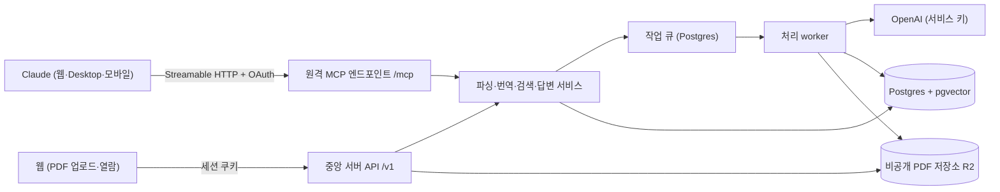

# 25. 원격 MCP 전환 설계 (#77)

작성일: 2026-11-15
상태: 제안 / 팀 합의 전

## 요약

사용자가 Python·PyTorch·모델·API 키를 설치하지 않고 **Claude에 커넥터 URL 하나를 추가하고
로그인하는 것만으로** 논문 학습을 시작하게 한다. 논문 처리(파싱·번역·임베딩·검색·답변)를
중앙 서버로 옮기고, 같은 서버가 Streamable HTTP MCP 엔드포인트를 제공한다.

[24. 로컬 MCP와 중앙 서버 병행 전환 결정](24-hybrid-server-transition.md)은 원격 MCP를 "재평가 조건"
충족 뒤로 미뤘다. 이 문서는 그 조건을 하나씩 다루고 MVP 범위와 단계별 구현 순서를 제안한다.
로컬 stdio MCP는 지금처럼 유지한다(병행 운영). 원격형이 안정화되기 전에 로컬형을 제거하지 않는다.

## 왜 지금 다시 보는가

- 로컬 설치가 8단계 정도로 길다. Python 3.12, venv, PyTorch를 포함한 wheel, `settings.env` 직접 작성(평문 API 키),
  `check`, `prepare-model`, `config`, Desktop 설정 JSON 병합을 거친다.
- Windows 첫 임베딩은 25초 중 22초가 PyTorch 계열 import였다(#119 실측, 2026-11-14).
  로컬 stdio MCP는 Desktop의 60초 대기에 걸린다.
- 24번의 단계 중 인증·기기, 논문 동기화, 학습 기록, 목록·상세 API, 컬렉션, PDF 업로드 API가
  구현되어(메모·PDF 열람·이어하기는 #213~#215에서 진행 중) 원격형에 필요한 기반(Auth0, Postgres, R2, presigned 업로드, 사용자 소유권 검사)이 이미 있다.

## Claude 원격 커넥터 요건 (2026-11 확인)

출처: [Claude connectors 문서](https://claude.com/docs/connectors/building.md),
[인증 문서](https://www.claude.com/docs/connectors/building/authentication),
[사용자 커넥터 안내](https://support.claude.com/en/articles/11503834).

| 항목 | 내용 | 우리에게 주는 의미 |
|---|---|---|
| Transport | Streamable HTTP 권장(HTTP+SSE는 폐지 예정) | 현재 FastMCP의 `streamable_http_app()`으로 제공 |
| 사용 위치 | claude.ai, Desktop, 모바일, Claude Code. 사용자는 Settings > Connectors에서 URL 추가 | Desktop의 `claude_desktop_config.json`에는 원격 서버를 넣지 않는다 |
| 요금제 | 커스텀 커넥터는 Pro·Max·Team·Enterprise | 무료 사용자 대상이면 별도 경로 필요(제외 범위) |
| 인증 | OAuth 2.0 + PKCE(S256). 클라이언트 등록은 DCR 또는 CIMD, 또는 사용자가 입력한 client id | Auth0의 DCR을 쓰거나, 우리 서버를 인가 서버 프록시로 둔다(아래 인증 참고) |
| 발견 | 인증 없는 요청에 401 + `WWW-Authenticate: Bearer resource_metadata=".../.well-known/oauth-protected-resource"` | 보호 리소스 메타데이터의 `resource`는 사용자가 입력한 MCP URL과 정확히 같아야 함 |
| 콜백 | `https://claude.ai/api/mcp/auth_callback`(향후 `https://claude.com/api/mcp/auth_callback`도 허용) | Auth0 허용 콜백에 둘 다 등록 |
| 토큰 | 만료 5분 전 선제 갱신, 401 시 갱신. 공개 클라이언트는 refresh token 회전 필요 | Auth0 refresh token rotation 사용 |
| 도구 대기 시간 | claude.ai·Desktop **300초** | 로컬 stdio의 60초 문제(#119)가 사라짐 |
| 결과 크기 | 약 150,000자 | 현재 [응답 크기 제한](../setup/url-response-size-limits.md)으로 충분 |
| 송신 IP | `160.79.104.0/21` | WAF 사용 시 허용 |
| 미지원 | 리소스 구독, sampling, client_credentials | 현재 도구는 사용하지 않음 |
| 첨부 파일 | 대화에 첨부한 파일이 MCP 서버에 전달된다는 문서 없음 | **PDF는 웹 업로드로 받는다** |
| MCP Apps(UI 카드) | 위 문서에 언급 없음 | 원격에서 카드 렌더링 여부를 스파이크로 확인(아래 미결) |

## 사용자 흐름 (MVP)

1. 사용자가 Claude Settings > Connectors에서 `https://<서비스 도메인>/mcp`를 추가하고 로그인한다(Auth0).
2. "이 논문 공부하고 싶어"라고 하면 MCP가 `prepare_paper_upload`로 **일회용 업로드 링크**를 돌려준다.
   사용자는 링크를 열어 웹에서 PDF를 선택한다. 웹은 이미 있는 presigned 업로드(#215)를 쓴다.
3. 업로드가 끝나면 서버가 처리 작업을 큐에 넣는다. MCP의 `get_paper_status`가 진행률을 보여준다.
4. 준비가 끝나면 `start_learning` → `ask_paper` → `get_evidence` 흐름은 지금과 같다.
5. 다른 기기·웹에서 같은 계정으로 이어서 학습한다. 동기화 단계가 필요 없다(서버가 기준).

로컬 파일 경로를 받는 `add_paper(path)`와 로컬 PDF 열기는 원격 MCP에서 제공하지 않는다.

## 설계 결정

### 1. 운영 형태: 병행

| 형태 | 대상 | 처리 위치 | API 키 | 설치 |
|---|---|---|---|---|
| 원격형(신규) | 일반 사용자 | 서버 | 서비스 키 | 커넥터 URL 추가 |
| 로컬형(유지) | 개발자·오프라인·비용을 직접 부담하려는 사용자 | 사용자 PC | 사용자 키 | 현재 방식 |

같은 코드베이스에서 서비스 계층(`application/*`)을 공유하고, 저장소 어댑터만 SQLite·Chroma(로컬)와
Postgres·pgvector(원격)로 나눈다. MCP 도구 계약(10번 문서)은 원격형에서도 같은 이름·출력을 유지하되,
로컬 경로를 받는 도구는 원격형에서 등록하지 않는다.

### 2. 인증과 사용자 격리

- **인가 서버**: Auth0를 그대로 쓴다. Claude 등록은 Auth0 DCR(Open Dynamic Registration)을 켜는 방법이
  가장 작다. DCR을 열기 싫다면 우리 서버가 `/register`만 처리하는 얇은 프록시를 두는 방법이 있다(미결 1).
- **리소스 서버**: `/mcp`는 Auth0가 발급한 access token(RS256, RFC 9068)을 기존 `OIDC_AUDIENCE` 검증 코드로
  확인한다. 토큰의 `sub`를 서버 사용자 ID로 매핑한다(웹 로그인과 같은 계정).
- **격리**: 모든 저장소 조회에 `owner_user_id` 조건을 강제한다. 기존 서버 API의 소유권 검사 방식을
  처리 데이터(청크·번역·벡터·context·근거·실행)까지 넓힌다. 다른 사용자의 ID로는 존재 여부도 드러내지 않는다(NOT_FOUND).
- **세션**: Streamable HTTP의 `Mcp-Session-Id`는 상태를 담지 않는 식별자로만 쓰고, 요청마다 토큰으로 사용자를 확인한다.

### 3. 데이터 저장소

| 데이터 | 로컬형 | 원격형 |
|---|---|---|
| 논문·버전·청크·번역·context·근거·실행 | SQLite | Postgres(사용자 소유권 컬럼 추가) |
| 벡터 | Chroma | **pgvector**(같은 DB, 트랜잭션·백업·소유권 필터 공유) |
| PDF | 로컬 관리 폴더 | R2 `private/files/`(기존) |
| 모델 | HF 캐시 | worker 이미지에 포함 |
| 진단 로그 | `DATA_ROOT/diagnostics` | 서버 로그(본문·키 없는 기존 단계 로그 형식 유지) |

Chroma 대신 pgvector를 쓰는 이유: 사용자별 필터와 삭제가 SQL 한 곳에서 끝나고, 별도 서비스를 운영하지 않는다.
논문당 청크 수가 수백 개 수준이라 HNSW 없이도 충분할 가능성이 높다(성능은 단계 2에서 측정).

### 4. 처리 worker와 작업 큐

- 업로드 완료 → `processing_jobs`에 작업 등록 → worker가 파싱·번역·임베딩·색인 게시.
  큐는 Postgres 테이블 + `SELECT ... FOR UPDATE SKIP LOCKED`로 시작한다(별도 브로커 없음).
- 기존 로컬 작업 단계(#119의 실행권·하트비트, 번역 복구 #30)를 그대로 옮긴다. 하트비트 10초·임대 60초 계약 유지.
- **임베딩**: worker는 상주 프로세스라 모델 로딩은 시작 시 한 번이다. Render 무료 인스턴스(512MB)에서는
  PyTorch가 부담이 크므로 같은 모델의 ONNX 실행을 우선 검토한다(미결 3). 모델을 바꾸지 않으면 기존 로컬 색인과 같은 의미 공간을 쓴다.
- `ask_paper`는 MCP 요청 안에서 동기로 실행한다(300초 대기). 질문 임베딩은 worker가 아니라 API 프로세스의
  공유 임베더를 쓴다. 메모리가 부족하면 API·worker를 한 프로세스로 합치는 것도 MVP에서는 허용한다.

### 5. 비용·사용량 제한과 외부 전송 고지

- OpenAI 키는 서비스가 소유한다(Render secret). 사용자에게 키를 받지 않는다.
- 제한(초기값 제안, 미결 2):
  - 사용자당 동시 처리 작업 1개, 하루 논문 처리 3편, 논문당 최대 50 MiB·300페이지(기존 업로드 한도와 맞춤)
  - 사용자당 하루 질문 100회, 질문당 기존 보완·의미 검증 횟수 제한 유지
  - 서비스 전체 월 비용 상한 도달 시 새 처리·질문을 `QUOTA_EXCEEDED`로 거부(기존 학습 기록 조회는 계속)
- 첫 연결과 첫 업로드 때 "논문 본문 일부와 질문이 OpenAI로 전송됩니다" 고지와 동의를 받는다
  ([외부 전송 데이터](../setup/external-data-transfer.md)의 문구를 원격형 기준으로 갱신). 동의 기록은 서버에 저장한다.

### 6. 보안

- 업로드: 기존 크기·형식·SHA-256 검증 + PDF 파서 실행은 worker 프로세스에서만, 시간·메모리 제한을 둔다.
- URL로 PDF를 가져오는 기능은 MVP에서 제외한다(SSRF 방어 범위를 키우지 않음).
- 토큰은 쿼리스트링으로 받지 않는다. 로그에 토큰·질문·본문을 남기지 않는 기존 진단 규칙을 유지한다.
- 업로드 링크는 사용자에 묶인 일회용·15분 만료 토큰으로 만든다. 링크만으로 다른 사용자 계정에 업로드할 수 없다.

### 7. 보존·삭제·백업

- PDF·처리 결과는 사용자가 삭제할 때까지 보존한다. 계정 삭제 시 30일 안에 PDF·벡터·처리 결과를 삭제한다(#368 tombstone 계약과 연결).
- Postgres는 Render 백업 정책을 따른다. R2는 운영 전 버전 관리 또는 복제 여부를 결정한다(render-staging의 기존 미결과 같음).
- 번역·벡터는 PDF에서 다시 만들 수 있는 파생 데이터로 본다. 백업 우선순위는 사용자 기록(메모·학습 기록·근거) > PDF > 파생 데이터.

### 8. 로컬형 데이터 이관

MVP에서는 자동 이관을 하지 않는다. 이미 서버에 동기화한 논문·메모·학습 기록은 원격형에서 그대로 보인다.
PDF를 업로드해 둔 논문은 원격형에서 "처리 시작"만 누르면 다시 처리한다(번역 비용 발생을 안내).
로컬 SQLite의 번역·벡터를 서버로 올리는 기능은 후속으로 검토한다.

## 기존 이슈에 미치는 영향

| 이슈 | 원격형에서의 상태 |
|---|---|
| #213, #368 동기화·삭제 | 로컬형 유지용으로 필요. 원격형 데이터는 처음부터 서버가 기준이라 동기화 불필요. tombstone 계약은 원격 삭제에도 재사용 |
| #214, #371~#375 메모·읽기 상태 | 서버 저장 계약은 원격형이 그대로 사용. 로컬→서버 전달 부분은 로컬형 전용 |
| #215 PDF 업로드 | 원격형 업로드의 기반으로 재사용 |
| #119, #242, #267, #99 | 로컬 stdio 전용. 원격형에서는 해당 없음(300초 대기, 서버 로그) |
| #108, #232, #31 | 형태와 무관. 그대로 진행 |

## 단계별 구현 계획

각 단계는 스테이징에서 공개 테스트 PDF로만 검증한다. 실제 사용자 데이터 업로드와 운영 공개는 단계 5 이후 별도 결정한다.

1. **연결 스파이크** (작음): `/mcp`에 Streamable HTTP + Auth0 OAuth(DCR)만 붙이고 `whoami` 도구 하나로
   claude.ai·Desktop 연결, 토큰 갱신, MCP Apps 카드 렌더링 여부를 확인한다.
2. **저장소 어댑터**: Postgres 처리 테이블(소유권 포함)과 pgvector 검색 어댑터. 기존 검색·답변 서비스 테스트를 두 어댑터로 실행.
3. **worker**: Postgres 큐, 파싱·번역·임베딩·색인 게시, 실행권·하트비트, ONNX 임베더.
4. **MCP 도구 연결**: 업로드 링크 → 상태 → `start_learning`·`ask_paper`·`get_evidence`·메모·퀴즈. 사용량 제한과 고지·동의.
5. **격리·장애 검증**: 두 계정 교차 접근 테스트, worker 중단 후 재개, 비용 상한 도달, 업로드 실패 복구.

담당(제안): A 저장소·큐·격리, B 검색·답변 어댑터와 ONNX 임베딩 검증, C MCP 엔드포인트·OAuth·업로드 흐름.

## 미결 사항

1. Auth0 DCR을 열지, 등록 프록시를 둘지. DCR은 누구나 클라이언트를 등록할 수 있게 하므로 Auth0 테넌트 정책을 확인한다.
2. 사용량 제한 초기값과 서비스 월 비용 상한. 무료 사용자·초대 사용자만 허용할지.
3. ONNX 임베딩이 기존 PyTorch 벡터와 검색 순위가 같은지(기존 측정 질문으로 상위 5개 비교). 다르면 원격형은 새 색인으로 시작한다.
4. MCP Apps(상세·퀴즈·대시보드 카드)가 원격 커넥터에서 렌더링되는지. 안 되면 텍스트 응답과 웹 링크로 대체한다.
5. 호스팅: Render 무료 인스턴스(512MB, 유휴 시 정지)로 worker까지 감당할 수 없으면 유료 인스턴스 또는 별도 worker 서비스.
6. 커스텀 커넥터가 무료 요금제에서 쓸 수 없다는 제약을 받아들일지.

## 완료 조건 (#77 대응)

- [x] 로컬·원격·병행 비교와 선택 근거: 위 1번
- [x] 호스트의 원격 transport·인증 지원 확인: Claude 원격 커넥터 요건
- [x] 사용자 흐름과 데이터 흐름: 사용자 흐름, 다이어그램
- [x] 격리·업로드·보존·비용·보안 방향: 설계 결정 2~7
- [ ] 미결 사항 1~6 팀 합의
- [ ] 단계별 후속 티켓 분리와 담당 확정
