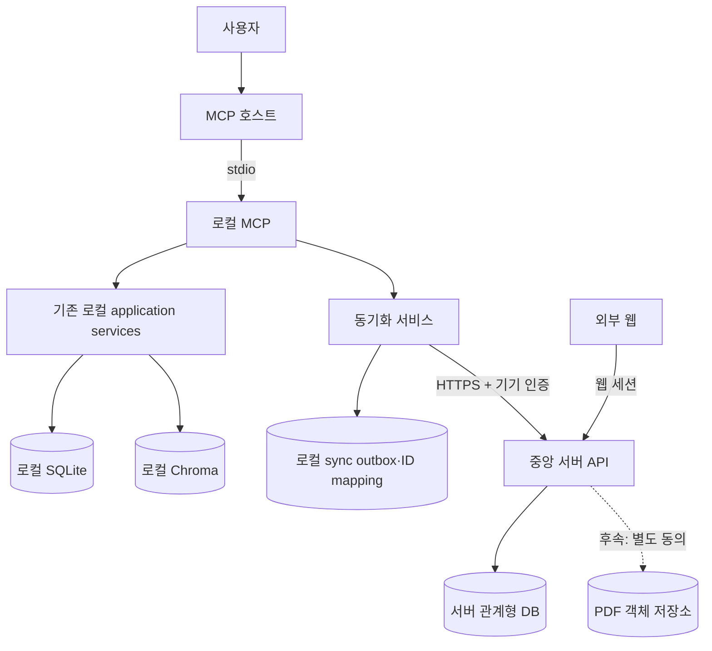
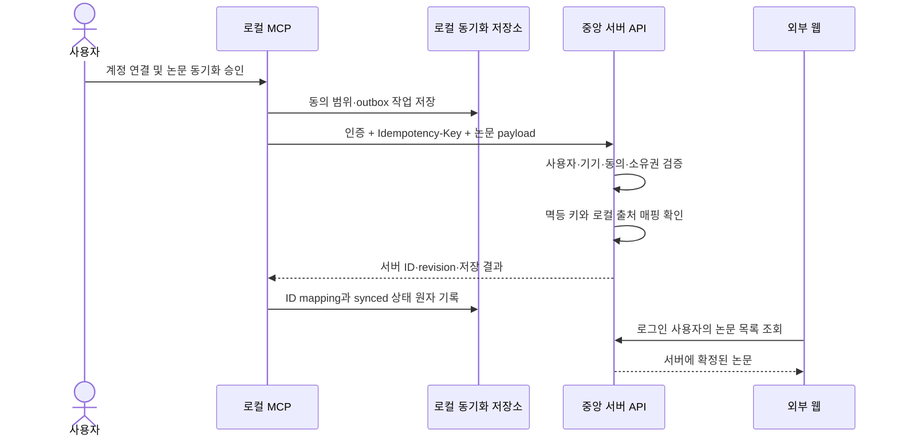

# 서버 동기화 데이터 흐름

작성일: 2026-11-12  
상태: 첫 세로 조각 구현 계약

이 문서는 [로컬 MCP와 중앙 서버 병행 전환 결정](../architecture/24-hybrid-server-transition.md)의
첫 구현 흐름을 정의한다. 현재 stdio MCP, 로컬 SQLite·Chroma와 PDF 처리를 원격 실행으로
자동 전환한다는 뜻이 아니다.

## 구성요소



## 첫 세로 조각의 요청

첫 구현은 논문 메타데이터 한 건만 다룬다. API 경로와 필드명은 OpenAPI 작성 시 확정하되
의미는 다음 계약을 유지한다.

```http
POST /v1/mcp/papers
Authorization: Bearer <device credential>
Idempotency-Key: <stable request key>
Content-Type: application/json
```

```json
{
  "source_instance_id": "local-installation-id",
  "local_paper_id": "local-paper-id",
  "title": null,
  "authors": null,
  "publication_year": null,
  "original_created_at": "2026-11-01T10:00:00+09:00"
}
```

`title`, `authors`, `publication_year`는 선택 필드다. 현재 로컬 `papers`에는 저자·출판 연도가
없고 기존 제목도 비어 있을 수 있다. 서버는 메타데이터 결측을 이유로 논문 등록을 거부하거나
등록일·업로드일로 출판일을 추정하지 않는다. 이후 확인된 메타데이터는 서버 ID와 마지막으로
확인한 서버 revision을 사용해 수정한다.

요청 본문에 회원 ID를 받더라도 소유권 판단에 사용하지 않는다. 서버는 검증된 인증 주체에서
사용자를 결정하고, 인증된 기기가 그 사용자에게 연결되어 있는지 확인한다.

```json
{
  "paper_id": "server-paper-id",
  "revision": 1,
  "sync_status": "stored",
  "server_updated_at": "2026-11-12T01:00:00Z"
}
```

동일한 소스 인스턴스와 로컬 논문 ID의 재등록은 같은 서버 논문 ID를 반환한다. 동일한
멱등 키와 payload의 재전송도 같은 결과를 반환한다. 같은 멱등 키에 다른 payload가 오면
새 논문을 만들지 않고 충돌 오류를 반환한다.

## 로컬 저장 상태

동기화 기능은 기존 도메인 테이블을 서버 상태 컬럼으로 오염시키지 않고 별도 저장소를 사용한다.
최소 논리 모델은 다음과 같다.

### server_object_mappings

| 필드 | 의미 |
|---|---|
| account_id | 현재 연결된 서버 계정의 로컬 식별자 |
| source_instance_id | 이 로컬 설치·데이터 출처의 안정적인 ID |
| object_type | paper, version, learning_record, annotation 등 |
| local_object_id | 기존 로컬 객체 ID |
| server_object_id | 서버가 발급한 ID |
| server_revision | 마지막으로 확인한 서버 수정 버전 |
| synced_at | 서버 성공 응답을 확인한 시각 |

계정·출처·객체 종류·로컬 객체 ID 조합은 하나의 서버 ID에만 연결된다. 계정을 변경했을 때
이전 계정의 매핑을 새 계정의 매핑으로 재사용하지 않는다.

### sync_outbox

| 필드 | 의미 |
|---|---|
| operation_id | 안정적인 로컬 작업 ID 및 멱등 키의 근거 |
| account_id | 전송 승인을 받은 서버 계정 |
| consent_scope_id | 이 전송을 허용한 동의 범위 |
| object_type / local_object_id | 전송할 로컬 객체 |
| operation | create, update, delete 후보 |
| payload_hash | 재시도 시 payload 변경 감지 |
| status | pending, sending, synced, failed, conflict |
| attempt_count | 전송 시도 횟수 |
| next_attempt_at | 일시 오류의 다음 시도 시각 |
| last_error_code | 본문·토큰이 없는 안전한 오류 코드 |

서버가 성공 응답을 반환하고 ID 매핑과 outbox 성공 상태를 같은 로컬 트랜잭션으로 기록한 뒤에만
원격 저장 완료로 표시한다. 응답 후 로컬 기록 전에 프로세스가 종료돼도 같은 멱등 키로 재시도해
기존 서버 결과를 복구한다.

## 학습 기록 투영

로컬 `learning_context`는 서버 `LearningRecord`와 같은 객체가 아니다. 동기화 계층은 로컬
컨텍스트를 출처 참조로 유지하면서 사용자 학습 기록을 별도로 투영한다.

| 서버 필드 | 로컬 근거 | 규칙 |
|---|---|---|
| source_context_id | learning_context.context_id | 연결 정보이며 서버 학습 기록 ID로 사용하지 않음 |
| server_version_id | context의 version_id 매핑 | 먼저 원문 버전 서버 ID를 확보함 |
| started_at | 명시적 학습 시작 성공 | context 생성 시각으로 임의 대체하지 않음 |
| last_learned_at | 실제 학습 위치 저장 시각 | 서버 업로드 시각으로 대체하지 않음 |
| last_position | 명시적으로 저장된 사용자 위치 | 검색된 근거 페이지로 추정하지 않음 |
| reading_status | 별도 상태 모델 | 파싱·질문·웹 열람으로 자동 변경하지 않음 |

이 필드의 로컬 근거가 아직 없으면 논문 메타데이터 세로 조각에는 포함하지 않는다. 외부 웹은
학습 기록 없음과 알 수 없는 위치를 정상적인 빈 값으로 처리한다.

## 목록 조회 adapter

현재 로컬 Annotation 라이브러리는 cursor 기반 키셋 조회를 사용한다. 외부 웹 티켓은 페이지 번호
이동과 전체 페이지 수를 요구하므로 서버 HTTP API가 로컬 cursor를 그대로 노출하지 않는다.

- MCP·로컬 조회: 기존 `limit`·`cursor` 계약 유지
- 서버 웹 조회: `page`·`limit`, `total_count`, `page_size`, `total_pages` 제공
- 서버 repository: 사용자 소유권 필터와 고정 보조 정렬을 포함한 별도 SQL 사용
- 날짜별 기록 수: 현재 page의 개수가 아니라 같은 전체 필터 결과에서 계산

한 응답에서 cursor와 page를 동시에 반환하지 않는다. 프론트가 페이지 번호를 요구하는 동안
서버가 cursor를 page 번호로 추정하거나 모든 앞 페이지를 순차 조회해서는 안 된다.

## 처리 순서



## 실패와 재시도

| 상황 | 로컬 처리 |
|---|---|
| 네트워크 실패·서버 5xx | 로컬 기능 유지, pending/failed로 보존하고 제한된 backoff 후 재시도 |
| 인증 만료 | 자동 무한 재시도 금지, 재인증 필요 상태로 표시 |
| 기기 해제 | 해당 기기 전송 중단, 새 연결 전까지 대기 기록을 보내지 않음 |
| payload 검증 실패 | 자동 재시도하지 않고 문제 필드와 안전한 오류 코드 표시 |
| 같은 키·다른 payload | conflict로 보존하고 새 키로 자동 우회하지 않음 |
| 오래된 server revision | conflict로 보존하고 사용자의 데이터 손실 없는 해소 절차를 요구 |
| 일부 하위 객체 실패 | 성공한 객체와 실패한 객체를 구분하며 전체 성공으로 표시하지 않음 |

재시도 횟수만으로 로컬 객체를 삭제하지 않는다. 오류 로그에는 인증정보, 메모·인용 본문,
로컬 절대경로와 전체 payload를 남기지 않는다.

## 후속 객체의 전송 순서

첫 세로 조각 이후에는 참조 무결성을 위해 다음 순서를 사용한다.

1. 논문
2. 원문 버전 메타데이터
3. 학습 기록과 위치 참조
4. 근거
5. 요약·메모·하이라이트·진행 위치·읽기 상태
6. 별도로 선택한 PDF

필요한 상위 서버 ID가 없으면 하위 객체를 성공 처리하지 않는다. 상위 객체가 저장된 뒤 같은
outbox 작업을 다시 평가한다. PDF 실패는 참조가 완전한 기록의 서버 저장을 되돌리지 않는다.

## 첫 세로 조각 완료 기준

- 로그인한 한 사용자의 기기만 논문을 등록할 수 있다.
- 같은 논문과 같은 요청을 반복해도 서버 논문이 중복되지 않는다.
- 로컬 ID와 서버 ID 매핑을 재시작 후에도 복구한다.
- 서버 장애 중 기존 로컬 MCP 조회·학습 기능이 계속 동작한다.
- 서버 성공 전에는 원격 저장 완료로 표시하지 않는다.
- 외부 웹 목록에서 서버에 확정된 논문을 조회한다.
- 다른 사용자의 ID를 전달해도 내용과 존재 여부가 노출되지 않는다.
- 기기를 해제하면 해당 자격으로 새로운 읽기·쓰기가 차단된다.
